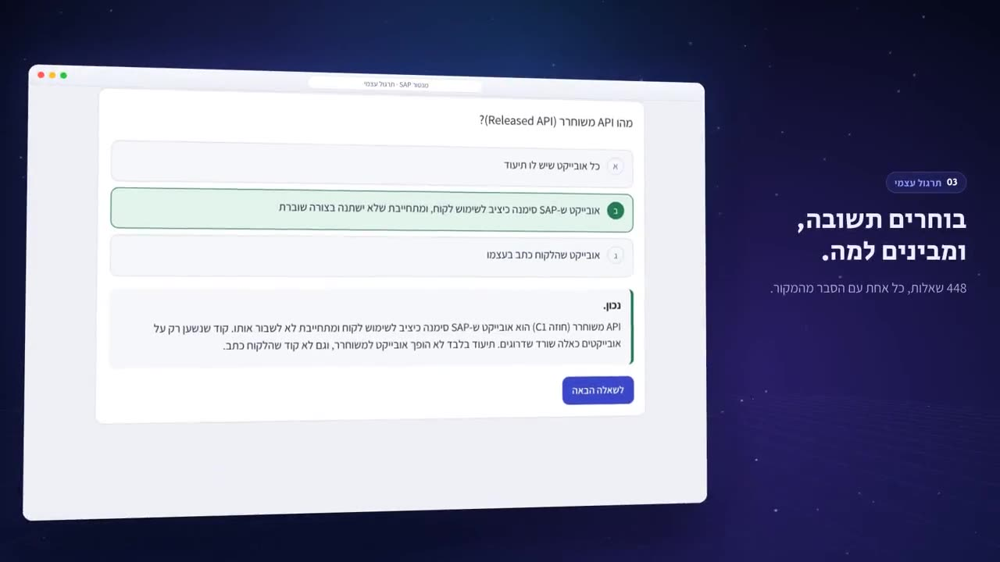

# SAP Mentor

An agentic AI platform for SAP implementers and ABAP developers: grounded answers with citations, S/4HANA clean-core code review, and spec review against an organization's own template.

Product video (3:31). On-screen text is in Hebrew and all data shown is fictional.

## What it does

- **Knowledge base:** a Hebrew library of 133 SAP topics and 448 practice questions. Answers are grounded in retrieved sources and cite them.
- **MCP integration layer:** an MCP server that exposes the knowledge base as tools to any MCP-compatible agent or IDE, and an MCP client hub for SAP-side servers such as ADT.
- **Hybrid retrieval:** pgvector similarity plus Postgres full-text search, fused with Reciprocal Rank Fusion and reranked.
- **Clean-core code review:** a deterministic rules engine, with no LLM call, that checks ABAP against S/4HANA simplification rules and SAP's open-source released-API lists.
- **Built for closed environments:** model-free checks, a local-embeddings mode, and LLM access isolated behind a single module.

## Stack

Python, FastAPI, PostgreSQL with pgvector, Anthropic Claude, Angular 19, Model Context Protocol.
